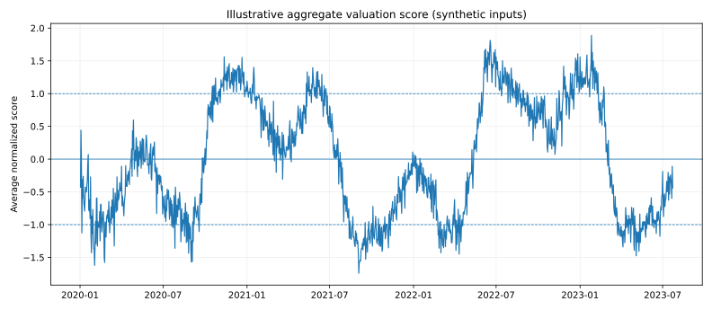
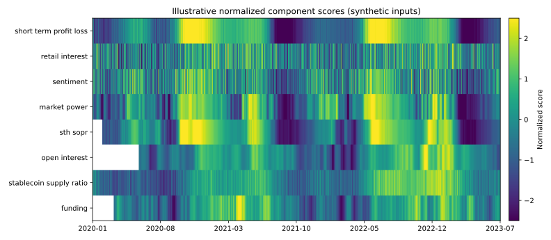

# Statistical Market Valuation

Personal research project exploring how heterogeneous Bitcoin on-chain, sentiment, and derivatives indicators can be transformed onto a more comparable statistical scale and combined into a descriptive valuation score.

The repository is a cleaned version of exploratory notebook work. It focuses on **normalization, transformation choice, signal aggregation, and the limitations of those choices**. It is not a production valuation model and it does not claim that the composite predicts returns or identifies repeatable market-timing opportunities.

## Research question

Different market indicators live on very different scales and distributions. The project asked a practical question:

> Can several structurally different Bitcoin indicators be transformed into comparable standardized scores and viewed together as a single descriptive market-state measure?

The original work experimented with rolling z-scores, smoothing, power transforms, Box-Cox, Yeo-Johnson, and rank-based Gaussian normalization before averaging the resulting component scores.

## Historical research visuals

The figures below are preserved from the original research rather than regenerated by the synthetic public demo.

### Short-term MVRV / NUPL normalization example


This four-panel diagnostic shows the original workflow on a real historical indicator: inspect the raw series and its moving statistics, inspect the raw skewed distribution, transform/standardize it, and then visualize the standardized valuation state against Bitcoin price. The probability-plot panel was used as a visual diagnostic of how close the transformed distribution came to normality.

### Historical aggregate valuation prototype


This later chart shows the early multi-indicator aggregate from the medium-term prototype. It should be read as an exploratory historical state measure, not a trading signal. The original write-up explicitly noted that early dates were sometimes based on only one or two available indicators and concluded that the aggregate did **not** show consistent actionable insights on its own.

## Research evolution

The project evolved in stages. The medium-term write-up documented an earlier five-indicator prototype and the automatic-normalization workflow. The later notebook expanded the idea into a broader eight-series transformation pipeline. The cleaned repository keeps both parts of that history explicit rather than presenting them as one frozen specification.

## Original research inputs

The later notebook worked with eight signal families:

- short-term holder profit/loss / NUPL-style data;
- retail-interest data;
- a futures sentiment index;
- a market-power indicator;
- short-term-holder SOPR multiples;
- aggregate futures open interest;
- stablecoin supply ratio; and
- futures funding rates.

Some of the original series came from credentialed or third-party analytics sources. Their raw data and credentials are **not redistributed** in this repository. The cleaned code accepts a pandas DataFrame containing the required input series, while the included demo uses deterministic synthetic data purely to show the mechanics.

## What is implemented

### 1. Reusable statistical transforms

`src/normalization.py` contains the small building blocks used throughout the research:

- conditional positive shifting for transforms that require positive inputs;
- square-root, cube-root, logarithmic, Box-Cox, and Yeo-Johnson transforms;
- rolling z-scores;
- rank-based Gaussian normalization;
- full-sample z-scores; and
- simple smoothing.

The original sign convention is retained: many scores are inverted so that a larger positive value corresponds to a relatively more favorable / cheaper reading under the research interpretation.

### 2. Indicator-specific normalization pipeline

`src/valuation.py` reconstructs the executable transformations used in the notebook:

| Component | Cleaned executable specification |
| --- | --- |
| Short-term profit/loss | square-root transform + 280-day rolling z-score |
| Retail interest | inverted rank-Gaussian normalization |
| Sentiment | log transform + 110-day rolling z-score |
| Market power | 8-day smoothing + Yeo-Johnson + 135-day rolling z-score |
| STH SOPR multiple | 30-day smoothing + Box-Cox + 170-day rolling z-score |
| Open interest | 25-day change, 5-day smoothing, 120-day volatility scaling, inverted rank-Gaussian normalization |
| Stablecoin supply ratio | inverted full-sample z-score |
| Funding | 20-day smoothing, 100-day volatility scaling, inverted rank-Gaussian normalization |

The component scores can then be averaged with `aggregate_valuation()`. The cleaned implementation adds a `min_components` requirement so early dates with very sparse indicator coverage are not silently treated as equivalent to dates with the full indicator set.

### 3. Automatic-normalization search

`src/search.py` retains the notebook's exploratory search idea: compare rolling-z-score windows, transformations, and smoothing choices using an average p-value from Shapiro-Wilk, Kolmogorov-Smirnov, and D'Agostino normality tests.

This is a **heuristic search tool**, not a statistically rigorous model-selection rule. Averaging p-values across different tests has no special theoretical justification; it was used as a practical way to rank candidate transformations during exploration.

## Reproducible demonstration

The original raw indicator history cannot be redistributed cleanly, so `examples/synthetic_demo.py` generates deterministic synthetic series with deliberately different distributions and runs them through the same cleaned transformation pipeline.





These figures demonstrate code behavior only. They are **not historical Bitcoin valuation results**.

Run the example from the repository root:

```bash
python examples/synthetic_demo.py
```

## Important notebook discrepancy

One markdown note in the original notebook described the STH SOPR transformation as a **-2 power transform with a 465-day moving z-score**. The executable cell instead applied a **30-day rolling mean, Box-Cox transform, and 170-day moving z-score**.

The cleaned repository follows the executable code and documents the disagreement rather than silently choosing whichever description sounds cleaner.

## Important limitations

- Several transformations were selected by inspecting the same historical data they were later visualized on, so the choices are vulnerable to in-sample overfitting.
- Rank-Gaussian normalization and the full-sample SSR z-score, as originally implemented, use the **entire available sample**. They therefore contain look-ahead information if interpreted as historical walk-forward signals.
- The indicator set has unequal history. A simple average can change meaning as new components become available; the cleaned code makes breadth explicit but does not solve that structural issue.
- A more Gaussian-looking indicator is not automatically a better valuation signal.
- The aggregate score was exploratory and was not established as a robust forecasting or trading model.
- Third-party data definitions can change and may require licensed or authenticated access.

These limitations are central to the project: the useful output is the transformation and aggregation framework, together with a clearer understanding of where a visually appealing historical valuation score can become statistically misleading.

## Repository structure

```text
.
├── .github/
│   └── workflows/
│       └── validate.yml
├── README.md
├── requirements.txt
├── docs/
│   ├── historical_aggregate_valuation.jpg
│   ├── historical_short_term_mvrv_nupl.jpg
│   └── research_history.md
├── examples/
│   ├── README.md
│   ├── synthetic_demo.py
│   └── output/
│       ├── synthetic_aggregate.svg
│       └── synthetic_components.svg
└── src/
    ├── __init__.py
    ├── normalization.py
    ├── search.py
    └── valuation.py
```

## Running the code

```bash
python -m venv .venv
source .venv/bin/activate  # Windows: .venv\Scripts\activate
pip install -r requirements.txt
python examples/synthetic_demo.py
```

For real research data, pass a DataFrame containing the eight expected input columns to `build_indicator_scores()` and keep the data-source licensing / authentication outside the research module.
